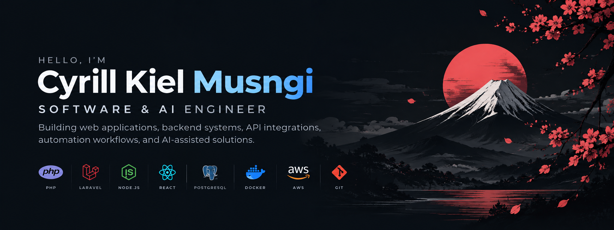

<div align="center">



<br/>

<a href="https://cyrillkm.online">
  
</a>
<a href="mailto:ckmusngi@gmail.com">
  
</a>

</div>

---

# 👋 Hi, I'm Cyrill Kiel Musngi

### Full Stack Software Engineer

Full Stack Software Engineer with **6+ years** of experience building web applications,
backend services, and integrations using **Laravel, Node.js, React, AWS, and GCP**.
I specialize in connecting SaaS platforms and payment gateways through REST APIs and webhooks,
and I work remotely with teams in **Australia and the UK**.

---

## 👨‍💻 About Me

- 💻 Building full-stack applications with **PHP (Laravel), Node.js, Python & React**
- 🔗 Integrating SaaS platforms: **Xero, HubSpot, Monday.com, MYOB**
- 💳 Integrating payment gateways: **Stripe, D24, Prontopaga, Dragontech88**
- 📈 Implementing conversion tracking with **GA4, Meta Conversions API & TikTok**
- ☁️ Deploying on **AWS, Google Cloud Platform, Docker & Nginx**
- 🧠 Using AI-assisted development tools such as **Claude & GitHub Copilot**
- 📍 Based in Pampanga, Philippines

---

## 🛠️ Tech Stack

### Backend

<p>
  
</p>

### Frontend

<p>
  
</p>

### Database

<p>
  
</p>

### Cloud & DevOps

<p>
  
</p>

### Tools

<p>
  
</p>

### Integrations

<p>
  
  
  
  
  
</p>

### Payments

<p>
  
  
  
  
</p>

### APIs

<p>
  
  
  
</p>

---

## 💼 Experience Highlights

<table>
  <tr>
    <td width="50%" valign="top">
      <h3>🇵🇭 Blue Wonders Consultancy</h3>
      <sub><b>Web Developer · Remote</b></sub>
      <p>Payment gateway integrations across Latin America and conversion tracking for campaign attribution.</p>
      
      
      
      
    </td>
    <td width="50%" valign="top">
      <h3>🇦🇺 Upstream</h3>
      <sub><b>Full Stack Developer · Contract</b></sub>
      <p>End-to-end full-stack projects and two-way accounting &amp; CRM integrations.</p>
      
      
      
      
    </td>
  </tr>
  <tr>
    <td width="50%" valign="top">
      <h3>🇵🇭 Quantum Crowd</h3>
      <sub><b>React.js · Blockchain Prototyping</b></sub>
      <p>React.js front-end development and blockchain prototyping.</p>
      
      
    </td>
    <td width="50%" valign="top">
      <h3>🇵🇭 Lagotronics</h3>
      <sub><b>Animatronics Programming</b></sub>
      <p>Animatronics programming for museum exhibits.</p>
      
      
    </td>
  </tr>
</table>

---

## 📊 GitHub Stats

<div align="center">


</div>

---

## 🔥 GitHub Streak

<div align="center">


</div>

---

## 🧠 What I'm Currently Working On

```text
💳 Payment gateway integrations across Latin America
📈 Conversion tracking & campaign attribution
🔗 SaaS & accounting system integrations
🤖 AI-powered developer tools (InterviewPrep AI)
🌐 Full-stack web applications
```
